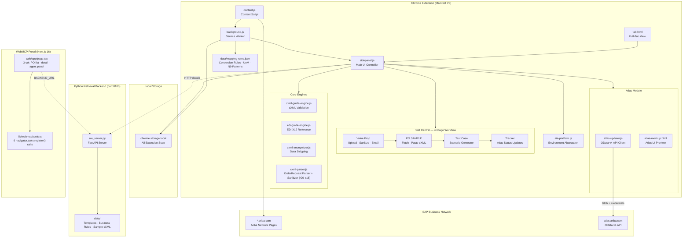

# Ariba Integration Agent — SAP Business Network Integration Assistant

Ariba Integration Agent (AIA) is a Chrome Extension (Manifest V3, v4.1.1) that accelerates supplier onboarding and EDI/cXML integration on the SAP Business Network. It provides an intelligent side panel that guides integration consultants and suppliers through the complete B2B connectivity setup — from initial onboarding stage tracking through field mapping validation, test plan generation, Atlas field updates, and Integration Guide Workbook (IGW) creation. The extension injects directly into Ariba Network pages, detecting context (supplier ANID, portal section) and surfacing relevant guidance automatically.

The agent operates with a local-first architecture: all business rules, mapping logic, and AI knowledge base run within the extension without external API calls. It supports EDI X12 ↔ cXML bidirectional field mapping across all major transaction types (850/855/856/810/820), automated error detection on Ariba UI5 pages, supplier readiness scoring, Test Central scenario generation, Atlas OData integration, and Excel-based IGW generation. A Python retrieval backend provides enhanced document search across integration templates, business rules, and master data. A WebMCP-powered web portal enables AI agents to directly access integration tools via browser-native tool registration.

## Features & Modules

| Module | Description |
|--------|-------------|
| **Supplier Onboarding Pipeline** | 6-stage tracking (Discovery → Config → Mapping → Testing → Go-Live → Monitoring) |
| **EDI ↔ cXML Mapping Engine** | Bidirectional field mapping for X12 850/855/856/810/820 transactions |
| **cXML Guide Engine** | Parse and validate cXML documents against Ariba schemas |
| **cXML Parser + Sanitizer** | Standalone OrderRequest parser with 17-rule sanitizer (r00–r16) — replaces real buyer/supplier data with test tokens |
| **EDI Guide Engine** | EDI X12 segment/element reference and validation |
| **cXML Anonymizer** | Strip sensitive data from cXML documents for sharing/debugging |
| **Transaction Store** | Local B2B transaction storage and replay |
| **Error Detection** | Auto-scan Ariba SAP UI5 DOM for integration errors with fix suggestions |
| **Test Central — Value Prop** | Upload cXML, run sanitizer, compose supplier outreach emails |
| **Test Central — PO SAMPLE** | Fetch or paste raw PO cXML for processing |
| **Test Central — Test Case** | Generate PO variant cXML scenarios (Multi-Line Split, No SupplierPartID, Ad-hoc Ship-To) |
| **Test Central — Tracker** | Atlas-backed test status tracking and updates |
| **Test Plan Generator** | Excel test plan generation (OC/ASN/INV/Credit Memo) via xlsx-js-style |
| **IGW Generator** | Integration Guide Workbook (Excel) generation with full field mapping details |
| **Atlas Updater** | OData v4 API integration with atlas.ariba.com — update SI/BRP fields programmatically |
| **Readiness Scoring** | Rule-based supplier integration readiness assessment |
| **AI Knowledge Base** | Local rule-based Q&A for Ariba integration guidance |
| **Context Detection** | 6-strategy ANID/org detection from Ariba Network pages |
| **Retrieval Backend** | Python server for document search (templates, business rules, master data) |
| **WebMCP Portal** | Next.js 16 web portal — 6 tools registered via `navigator.tools.register()` for AI agent access |
| **Tab/Panel Modes** | Side panel + full-tab view for wider workspace |

## Architecture



## File Structure

```
background.js              ← Service worker: message router, AI KB, IGW/test plan generation
content.js                 ← Injected into *.ariba.com: FAB, context detection, error scan
sidepanel.js               ← Main UI controller: nav, tabs, all panel logic
sidepanel.html             ← Side panel shell (Test Central 4-stage stepper)
tab.html / index.html      ← Full-tab workspace view
aia-platform.js            ← Environment abstraction (extension vs web app)
cxml-guide-engine.js       ← cXML document parsing and validation
edi-guide-engine.js        ← EDI X12 segment reference
cxml-parser.js             ← Standalone cXML OrderRequest parser + 17-rule sanitizer
cxml-anonymizer.js         ← Sensitive data stripping
atlas-updater.js           ← Atlas OData v4 API — SI/BRP field updates
atlas-mockup.html          ← Atlas UI workflow mockup
build-ext.sh               ← Extension build and packaging script
data/mapping-rules.json    ← Deterministic EDI↔cXML conversion rules, UoM, N9 patterns
aie-backend/
  └── aie_server.py        ← FastAPI retrieval server (port 8100)
web/                       ← Next.js 16 WebMCP portal
  ├── app/page.tsx         ← Main portal (3-col layout)
  ├── app/demo/page.tsx    ← /demo landing for judges
  ├── lib/webmcp/tools.ts  ← 6 navigator.tools.register() calls
  └── lib/ariba/mock.ts    ← Mock POs, scenarios, onboarding checklist
AIA_Handover.md            ← Complete technical reference for future development
```

## Tech Stack

- Chrome Extension Manifest V3 (no bundler, IIFE module pattern)
- Vanilla JavaScript
- Python 3 / FastAPI (retrieval backend, port 8100)
- Next.js 16 (WebMCP portal)
- SheetJS / xlsx-js-style (Excel generation for IGW and test plans)
- JSZip (archive handling)
- chrome.storage.local (all extension state)
- Chrome Side Panel API
- Fetch + OData v4 (Atlas integration)
- WebMCP (`navigator.tools.register()`)

## Installation

1. Clone or download the repository
2. Open Chrome → `chrome://extensions/` → Enable **Developer mode**
3. Click **Load unpacked** → select this folder
4. Navigate to any `*.ariba.com` page and open the side panel (`⌘+Shift+A` / `Ctrl+Shift+A`)

### Optional: Python Retrieval Backend

```bash
cd aie-backend
pip install -r requirements.txt
uvicorn aie_server:app --port 8100 --reload
```

### Optional: WebMCP Portal

```bash
cd web && npm install
npm run dev          # http://localhost:3000
# With real backend:
BACKEND_URL=http://localhost:8100 npm run dev
```

## Test Central Workflow

The **Test Central** module is a 4-stage stepper workflow:

| Stage | Name | Purpose |
|-------|------|---------|
| 1 | **Value Prop** | Upload cXML, run 17-rule sanitizer, compose supplier outreach emails |
| 2 | **PO SAMPLE** | Fetch or paste the raw PO cXML to process |
| 3 | **Test Case** | Generate PO variant cXML test scenarios |
| 4 | **Tracker** | Track test status via Atlas OData updates |

### cXML Sanitizer Rules (r00–r16)

The sanitizer strips all real buyer/supplier data and replaces it with neutral test tokens:

| Rule | Field | Replaced With |
|------|-------|---------------|
| r00 | `cXML.timestamp` | `#TIMESTAMP#` |
| r01 | `cXML.payloadID` | `#PAYLOADID#` |
| r02 | `deploymentMode=production` | `test` |
| r03 | `From/Identity` | `#SENDERID#` |
| r04 | `To/Identity` | `#RECEIVERID#` |
| r05 | `Sender/Identity` | `#PROVIDERID#` |
| r06 | `orderDate` | `#DATETIME#` |
| r07 | `orderID` | `#DOCUMENTID#` |
| r08–r09 | Blanket PO fields | `#DOCUMENTID#` / `#PAYLOADID#` |
| r10 | `requestedDeliveryDate` year | +100 |
| r11–r12 | Service/blanket PO dates | past / +100 |
| r13–r14 | ShipFrom / RemitTo address | test (PA, US 15212) |
| r15–r16 | ServicePeriod dates | `#DATETIME#` |

### Test Case Scenarios

| Scenario | Description |
|----------|-------------|
| Multi-Line Split | First ItemOut split into 3 equal lines — tests multi-line PO handling |
| No SupplierPartID | All SupplierPartID elements removed — buyer-only catalog reference |
| Ad-hoc Ship-To | Ship-To name prefixed `ADBUYER-` — non-standard delivery address |

Test plans are exported as Excel workbooks with OC / ASN / INV / Credit Memo columns per scenario.

## Atlas Integration

`atlas-updater.js` connects to `atlas.ariba.com` via OData v4 (`/Atlas/api/data/v9.1`) to update Supplier Integration (SI) and Buyer Regional Playbook (BRP) records directly from the extension, without manual Atlas UI navigation.

## WebMCP Portal — 6 Tools

The web portal registers 6 tools for AI agent access via `navigator.tools.register()`:

| Tool | Purpose |
|------|---------|
| `list_purchase_orders` | All POs with readiness scores |
| `get_po_details` | Full PO + onboarding checklist |
| `generate_test_scenarios` | 3 cXML variants |
| `validate_cxml_document` | Schema + business rule validation |
| `get_integration_guide` | Excel IGW with EDI↔cXML mappings |
| `get_business_rules` | Transformation rules + fallbacks |

## Developer Reference

For full API documentation, architecture details, module specs, and implementation notes for future development, see [AIA_Handover.md](AIA_Handover.md).
